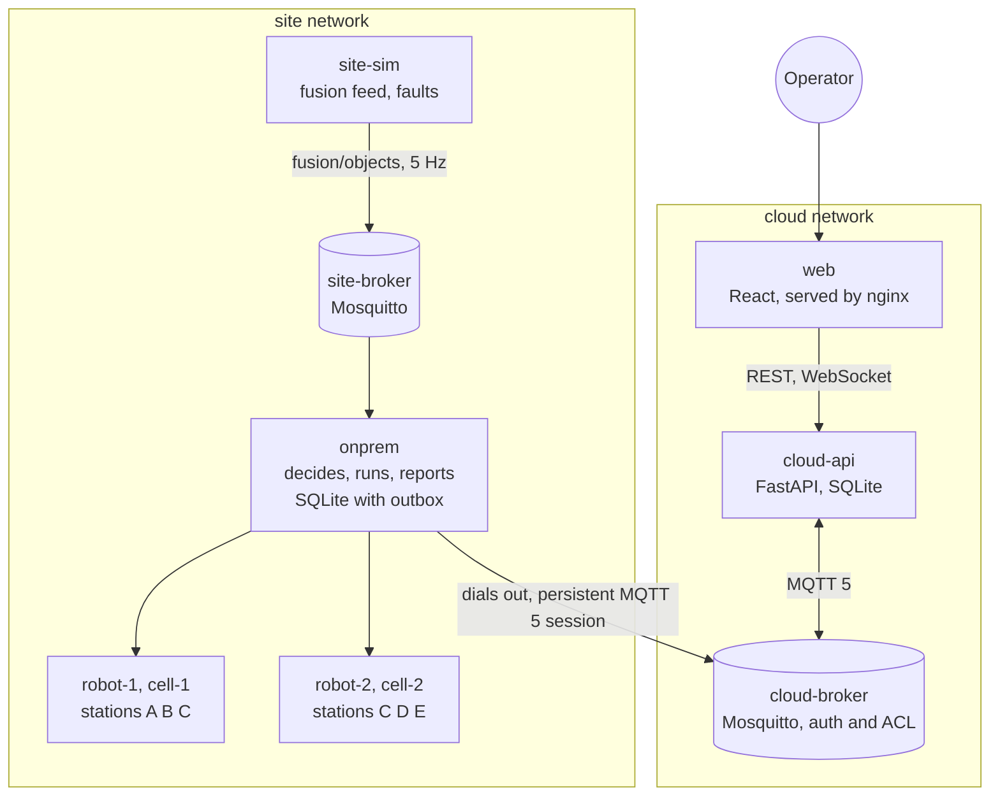
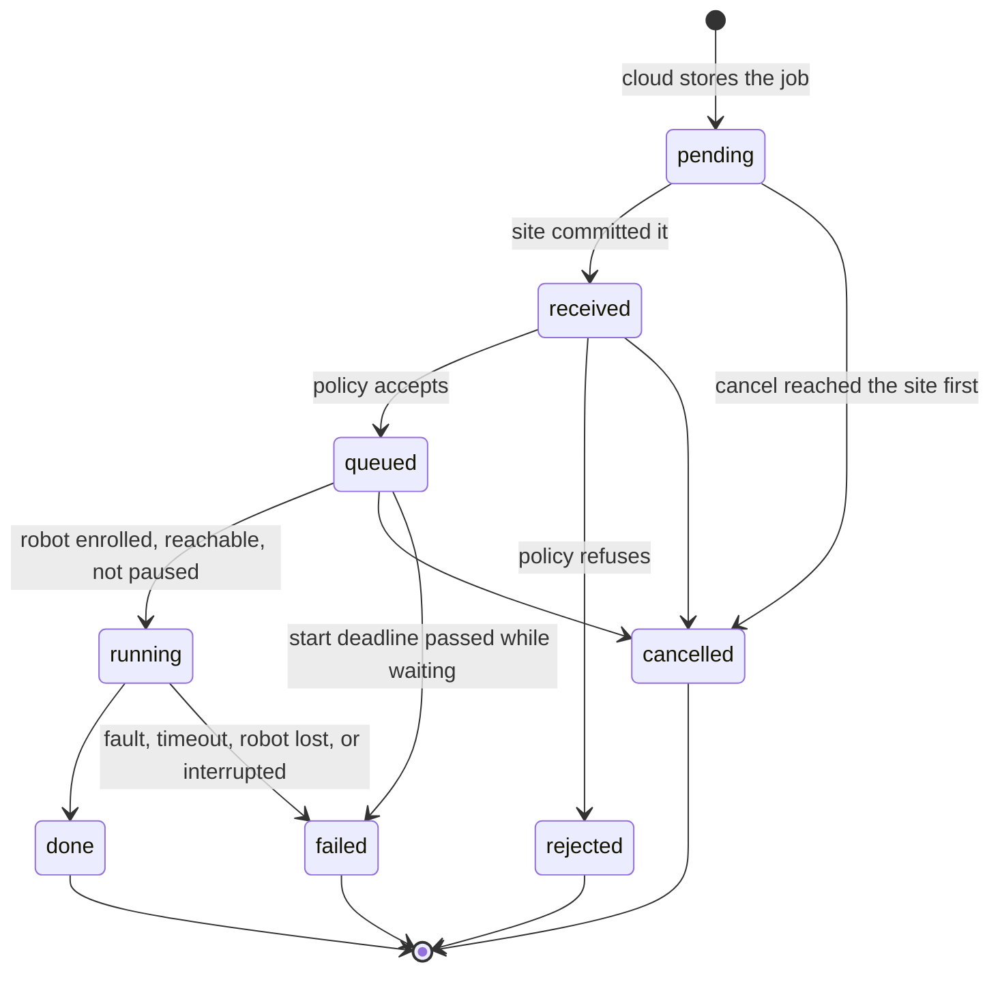
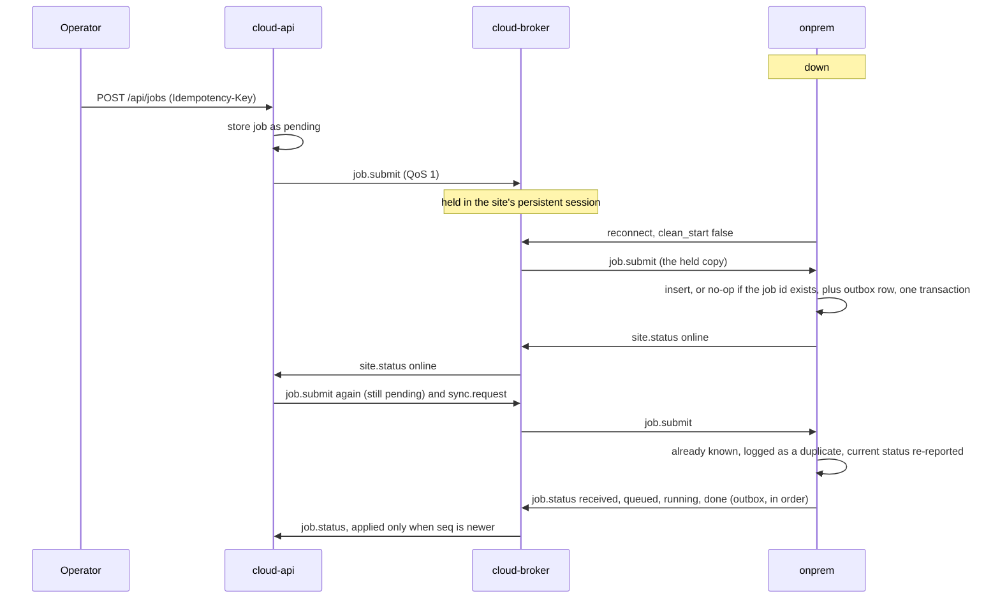

# Remote Robot Cell

An operator in a cloud web app sends pick and place jobs to two robot arms at a customer site.
An on-prem server decides whether and when each job runs, drives the (simulated) arms, pauses
them when a person walks into their cell, and reports every change back to the cloud over MQTT.

The rule the whole system is built around: **the cloud asks, the site decides, the robot acts,
the site reports.**

- [Running it](#running-it)
- [Architecture](#architecture)
- [MQTT topics and messages](#mqtt-topics-and-messages)
- [Job lifecycle](#job-lifecycle)
- [Design decisions](#design-decisions)
- [Assumptions](#assumptions)
- [Testing](#testing)
- [Code layout](#code-layout)
- [What I would do next](#what-i-would-do-next)

## Running it

You need Docker with Compose v2. `make` is optional, and every target is a thin wrapper.
`uv` and `pnpm` are only needed to run the tests or the scripts outside Docker.

```bash
docker compose up --build        # or: make up
```

| What | Where |
|---|---|
| Operator console | http://localhost:3000 |
| Site simulator, to place people and inject faults | http://localhost:8090 |
| Cloud API docs | http://localhost:8000/docs |

A first run takes a minute or two to build. Then:

1. Open the console. Both robots show up as discovered but not enrolled. Click **Enroll** on
   each (or `make enroll`).
2. Send jobs from the form, or `make jobs N=6`. `make jobs-invalid` sends jobs the site has to
   reject.
3. Take the site offline with `make onprem-stop`, send a couple of jobs (they stay pending),
   then `make onprem-start` and watch each one run once.
4. In the simulator, click **Walk into cell 1** while robot-1 is busy. It pauses as the person
   crosses into the cell and resumes about two seconds after they leave. **Stand at station
   C** pauses both robots. **Stop feed** shows the fail-safe.

`make help` lists everything. `make reset` wipes all data. `FAILURE_RATE` in `.env` (see
`.env.example`) controls how often a simulated job fails, 15% by default.

## Architecture



Six containers on two Docker networks. `cloud` stands in for the hosted side and `site` for the
customer LAN. Only `onprem` is attached to both, and it only ever connects outward.

| Service | Role |
|---|---|
| `cloud-broker` | Mosquitto with a password file and an ACL that pins each site to its own topic subtree. Persistence is on, so commands queued for an offline site survive a broker restart. |
| `cloud-api` | FastAPI. Stores jobs, reconciles them with the site, and serves REST plus a WebSocket feed. SQLite. |
| `web` | React and TypeScript, built with Vite and served by nginx. nginx also proxies `/api` and `/api/ws`. |
| `site-broker` | Mosquitto on the site LAN. Carries the fusion feed and the simulator's fault messages. |
| `onprem` | Plain asyncio Python. Policy, per-robot queues, the simulated arms, the safety monitor, and the links to both brokers. SQLite. |
| `site-sim` | Publishes `fusion/objects` in the site format and lets you walk people around or break things. |

There are two brokers on purpose. On a real site the fusion service publishes on a local broker,
and the safety decision should not depend on anything outside the building. Keeping the fusion
feed on its own broker and network makes that structural rather than a convention.

## MQTT topics and messages

Everything between the cloud and a site lives under `rc/v1/sites/{site_id}/`. The version is in
the topic so a breaking change can run side by side with the old one.

| Topic | Direction | QoS | Retained | Messages |
|---|---|---|---|---|
| `rc/v1/sites/{site}/commands` | cloud to site | 1 | no | `job.submit`, `job.cancel`, `robot.enroll`, `robot.unenroll`, `sync.request` |
| `rc/v1/sites/{site}/events` | site to cloud | 1 | no | `job.status`, `command.result` |
| `rc/v1/sites/{site}/status` | site to cloud | 1 | yes | `site.status`, as a birth message, a Last Will, and an explicit offline notice on shutdown |
| `rc/v1/sites/{site}/heartbeat` | site to cloud | 0 | no | `site.heartbeat` every 5 s |
| `rc/v1/sites/{site}/robots/{robot}/state` | site to cloud | 1 | yes | `robot.state`, the full snapshot of one robot |
| `rc/v1/cloud/status` | cloud | 1 | yes | `cloud.status` birth and Last Will, for monitoring |
| `fusion/objects` | site LAN only | 0 | no | Tracked objects, in the format from the brief |
| `sim/robots/{robot}/fault` | site LAN only | 1 | yes | `sim.robot_fault`, simulator only |

All commands to a site share one topic because MQTT only guarantees ordering within a topic. A
`job.cancel` must never overtake the `job.submit` it refers to.

Every message except the fusion frame uses the same envelope. `msg_id` makes a message
traceable in logs, and `type` selects the payload model. The models live in
[`packages/protocol`](packages/protocol), which both services import, so neither side can
drift on a message shape.

```json
{
  "v": 1,
  "type": "job.submit",
  "msg_id": "0c1f4b8e3d0a4c6e9a1d2b7f5e3c9a10",
  "ts": 1763030400123,
  "data": {
    "job_id": "3f9e2a7c41d84b0f9c6e5a1b2d3c4e5f",
    "robot_id": "robot-1",
    "pick": "A",
    "place": "C",
    "created_at": 1763030400100,
    "start_deadline": 1763032200100
  }
}
```

<details>
<summary>The other payloads (<code>data</code> only)</summary>

```jsonc
// job.cancel
{ "job_id": "3f9e..." }

// robot.enroll: the serial must match what the site has for that robot
{ "robot_id": "robot-1", "serial": "SIM-ARM-1001" }

// robot.unenroll
{ "robot_id": "robot-1" }

// sync.request: jobs the cloud still considers open; the site re-reports each one it knows
{ "job_ids": ["3f9e...", "a41c..."] }

// job.status: seq increases by one per transition and orders the updates for the cloud
{ "job_id": "3f9e...", "robot_id": "robot-1", "status": "failed", "seq": 4,
  "at": 1763030407311, "reason": "gripper_fault" }

// command.result: answers enroll, unenroll and refused cancels
{ "command": "job.cancel", "target": "3f9e...", "ok": false, "reason": "already_running" }

// site.status
{ "online": true, "boot_id": "b81d...", "version": "0.1.0", "started_at": 1763030390000 }

// site.heartbeat
{ "boot_id": "b81d...", "uptime_s": 312.5 }

// robot.state
{
  "robot_id": "robot-1", "serial": "SIM-ARM-1001", "model": "sim-arm-6", "cell": "cell-1",
  "stations": ["A", "B", "C"], "enrollment": "enrolled", "connected": true, "state": "paused",
  "pause": { "reason": "person_in_cell", "since": 1763030405120, "cells": ["cell-1"],
             "track_ids": [1042], "latency_ms": 2 },
  "current": { "job_id": "3f9e...", "pick": "A", "place": "C", "step": "move_to_place",
               "progress": 0.61 },
  "queue": ["a41c..."], "waiting_for": null, "updated_at": 1763030405121
}
```

`fusion/objects` uses the site format unchanged (`ts`, `t_ms`, and `objects` with `gid`, `class`,
`kf_pos`, `velocity`, `speed` and so on). Only `class` and `kf_pos` drive decisions.

</details>

## Job lifecycle



`pending` is the only state the cloud ever writes. Every later state is decided and reported by
the site.

| Reason | When |
|---|---|
| `unknown_robot`, `robot_not_enrolled` | Rejected: the site doesn't know the robot, or it isn't enrolled |
| `station_not_reachable`, `same_station` | Rejected: the stations don't suit this robot |
| `queue_full` | Rejected: the robot already has 10 jobs waiting |
| `expired` | Rejected, or failed if it expired in the queue: the job could not start before its deadline |
| `gripper_fault`, `part_missing`, `path_blocked` | Failed: simulated faults |
| `timeout` | Failed: more than 30 s of motion time, not counting time spent paused |
| `robot_disconnected` | Failed: the robot's heartbeat to the site was lost mid-job |
| `interrupted` | Failed: the site restarted while the job was running |

## Design decisions

### The cloud asks, the site decides

The cloud stores what the operator asked for and shows what the site reports. It doesn't
validate whether a robot can reach a station (the form filters stations as a convenience, but
the API accepts any). It doesn't time out or fail jobs, and it never invents a terminal state.
If the site is offline, a running job stays `running` with its last known progress, and the UI
says the site is offline. Every rule that affects the robots lives on the site, so the site's
answer is the only one that counts.

### Connection between cloud and site

- **The site always dials out.** No inbound port is needed at the customer, which is what
  works behind real factory firewalls and NAT.
- **Credentials and ACL.** Each site authenticates with its own credentials, using the site id
  as username. The ACL lets a site read only `rc/v1/sites/<itself>/commands` and write only its
  own reports. A compromised site can't see or impersonate another site. In production this
  would be TLS on 8883 with a per-site client certificate (`use_identity_as_username`) instead
  of a password.
- **Persistent sessions on both sides.** MQTT 5, fixed client ids, `clean_start = false`, and a
  7 day session expiry. While the site is down, the broker queues QoS 1 commands for it. While
  the cloud API is down, it queues the site's reports.
- **Liveness.**
  - The site publishes a retained `online` birth message and registers a retained `offline`
    Last Will.
  - A clean `docker compose stop` doesn't fire a Last Will, so the site also publishes
    `offline` itself on shutdown.
  - A 5 s heartbeat covers half-open connections: the cloud marks the site offline after 15 s
    of silence.
  - An `offline` message carrying an older `boot_id` is ignored. This avoids a race where a
    stale will arrives after the new boot's birth.
- **Resync.** When the cloud sees a site come online, or come back with a new `boot_id`, it
  re-sends everything still unanswered and sends `sync.request` for the jobs it considers
  open. The cloud does the same whenever it reconnects to the broker itself.

### Enrollment

Enrollment is a two-party handshake. The site proves the robot exists, an operator approves it
in the cloud, and the site confirms.

1. The site knows its robots from local configuration ([`config/site.yaml`](config/site.yaml),
   standing in for controller discovery). It publishes each one as `unenrolled`.
2. The operator clicks **Enroll**. The cloud records the request and sends `robot.enroll` with
   the serial number the site reported, re-sending with backoff until it gets an answer.
3. The site checks that the robot exists and the serial matches its own inventory, persists the
   enrollment, and publishes the robot as `enrolled`. A mismatch comes back as a refusal that
   the UI shows.
4. The cloud API refuses jobs for a robot that isn't enrolled, and the site rejects them anyway
   in case the cloud's view is stale. Unenrolling is refused while the robot has work.

The site trusts its own inventory, so the cloud can't conjure a robot into existence. The
operator controls which robots take jobs. The serial check stops an enrollment request from
binding to a different physical machine that happens to have the same name.

### Exactly-once execution

MQTT gives at-most-once or at-least-once delivery, not exactly-once. Exactly-once *execution*
is built from at-least-once delivery plus idempotent processing. The proof that the site has a
job is the site's own `received` report, never a broker acknowledgement.



- **Intake is idempotent at every hop.** The browser sends an `Idempotency-Key`, so a
  double-clicked or retried POST creates one job. The site stores a job with
  `INSERT ... ON CONFLICT (job_id) DO NOTHING`, so a redelivered command changes nothing.
- **A job starts once.** `queued` to `running` is a compare-and-set in the database
  (`UPDATE ... WHERE status = 'queued'`) that commits before the arm moves.
- **Reports are never lost.** Every status change and its outgoing event are written in the
  same SQLite transaction (a transactional outbox). A publisher drains the outbox in order and
  marks each row sent only after the broker acknowledges it. The payload is stored already
  encoded, so a retry sends the identical message.
- **Reports apply once, in order.** The cloud applies a status only if its `seq` is newer than
  the one it has, and keeps every report in a history table.
- **Crash during a job.** On start, the site fails any job it finds in `running` as
  `interrupted` and does not run it again. The arm may have stopped halfway with a part in the
  gripper, and re-running a physical action without a human looking is the "twice" that
  matters. Queued jobs go back into their queues in order. On a graceful stop, the site first
  lets running jobs finish (up to 12 s).

| Failure | What happens |
|---|---|
| Site down when the job is sent | Broker holds the command. The cloud re-sends on reconnect anyway, and the site dedups. |
| Site crashes after storing a job, before reporting it | The `received` event is already in the outbox and goes out after restart. The cloud's re-send gets a duplicate reply carrying the current status. |
| Site crashes mid-job | `failed` with reason `interrupted`, never re-run. |
| Cloud API down while the site reports | Outbox plus the cloud's persistent session hold the reports. On reconnect the cloud also sends `sync.request`. |
| Broker restart | Persisted sessions and queued messages survive. Both sides reconnect and resync. |
| Duplicate or reordered deliveries | Dedup on the site, sequence check in the cloud. |
| Operator double-clicks Send | Same idempotency key, same job. |

### Safety pause

- **Decided entirely on the site.** The path is fusion frame on the site broker, then the
  safety monitor, then `arm.halt()`, all in one process. The cloud, the cloud broker and the
  database are not involved. The cloud only receives a report afterwards. Stop `cloud-broker`
  and robots still pause.
- **Occupancy.** A cell is occupied when a `person`'s `kf_pos` is inside the cell's rectangle.
  Other classes (forklifts) are ignored by default, and the list is configurable.
- **Fast to stop, slow to restart.** A robot pauses on the first frame showing someone in its
  cell, and the site measures 1 to 2 ms from frame timestamp to halt. The arm stops within one
  50 ms motion tick. It resumes only after the cell has been clear for 2 s, which also rides
  out a track that flickers out for a frame while the person is still there.
- **Missing data counts as unsafe.** No frame for 1 s pauses every robot (`safety_feed_lost`).
  Robots start paused (`awaiting_safety_feed`) until the first frame arrives after a restart.
- **A pause is a robot state, not a job state.** The job stays `running`, time spent paused
  doesn't count against its runtime limit, and on resume the arm continues where it stopped.
  A paused robot doesn't start queued jobs.
- **The cloud shows why.** The robot snapshot carries the reason, the cells, the track ids,
  the start time and the measured latency.

This is an operational layer on top of the cell's certified safety equipment (light curtains,
scanners and a safety PLC under ISO 10218 and ISO 13849). It is not a replacement for that
equipment.

### Station C

Both robots can reach station C. Two things follow from that:

- **The site serializes access.** It holds a lock per station, and an arm takes the lock from
  the move into the station until it finishes the pick or place there. An arm never holds two
  stations at once, so the two arms can't deadlock. The waiting arm shows "waiting for station
  C". A paused arm keeps the station it is standing in.
- **C sits in the strip where the two cells overlap.** A person standing at C is inside both
  cells and pauses both robots.

### Persistence

Both services use SQLite in WAL mode with `synchronous=FULL`, on named Docker volumes, so job
history survives restarts and rebuilds. Each service has a single connection with serialized
transactions, which is plenty at this scale and keeps the transactional guarantees obvious.

### Bonus items

- **Online and offline status from heartbeats.**
  - The site: birth message, Last Will and a 5 s heartbeat with a 15 s timeout.
  - Each robot: its controller heartbeats to the site every second, and the site marks it
    offline after 3 s of silence. The job it was running fails with `robot_disconnected`, and
    any station it held is released. Try **Unplug** in the simulator.
- **Cancel.** Works for any job that hasn't started. Because the cloud only asks, a cancel is a
  request until the site answers:
  - A cancel that arrives before its job leaves a tombstone, so the job arrives already
    cancelled.
  - A running job can't be cancelled from the cloud. The site refuses, and the UI says so.
- **Timeouts and retries.**
  - The cloud re-sends unanswered submits, cancels and enrollments with exponential backoff
    (2 s doubling to 60 s), but only while the site is online.
  - Every job has a start deadline that the site enforces. The operator picks it from 5
    minutes to 24 hours, with 30 minutes as the default.
  - A running job has a 30 s motion-time limit. The simulator's **Stall** button triggers it.
- **Other things I think matter in a real deployment.**
  - Per-site broker credentials and ACLs, for tenant isolation.
  - The fail-safe safety feed.
  - Idempotent intake.
  - Draining running jobs on shutdown.
  - A versioned protocol in one shared package.
  - Healthcheck-gated startup and non-root containers.
  - CI that runs the full stack end to end.

## Assumptions

1. **One site** with one on-prem server and two robots. Topics, schemas and the ACL already
   allow many sites, but the UI shows one.
2. **Station C is a shared transfer station** in the strip where both cells overlap. Both arms
   can reach it, but only one at a time.
3. **The robot inventory lives at the site.** [`config/site.yaml`](config/site.yaml) stands in
   for discovering controllers on the network.
4. **Site credentials are provisioned at installation.** How a site gets them (a claim code, a
   certificate) is out of scope.
5. **Who owns what.** The cloud is the system of record for what was asked. The site is the
   system of record for what happened. Only the site sets job states after `pending`.
6. **Interrupted jobs are not re-run.** A job interrupted by a site crash is failed, and the
   operator decides whether to resend it.
7. **`cancelled` is an extra terminal state** beyond the brief's list. Cancelling a pending job
   is a request: if the site has already started it, the site refuses and the UI says so.
8. **Jobs carry a start deadline**, and cloud and site clocks are NTP-synced. A job submitted
   during a long outage must not start hours later without anyone noticing.
9. **Queues.** Each robot queues at most 10 jobs, first in first out in the order the site
   accepted them. Paused or disconnected robots still accept jobs into their queue.
10. **Pause rules.** Only people trigger a pause. The rectangle test uses `kf_pos`, the filtered
    current position, rather than `avg_pos`.
11. **Timing.** 2 s clear before resuming, and 1 s of silence counts as a lost feed. Both are
    configurable.
12. **The operator console has no login.** It assumes a single trusted operator.
13. **MQTT is unencrypted** inside Docker. The site broker trusts anything on the site LAN.
14. **Simulation.** A job takes 4 to 8 s depending on station distances, and fails at a random
    step 15% of the time.

## Testing

```bash
make test        # unit tests: uv run pytest
make lint        # ruff
make e2e         # end to end checks against a running stack
```

- **Unit tests** cover:
  - the protocol: envelopes, lifecycle rules and topics
  - the site: policy, dedup, tombstones, crash recovery, deadline expiry, pause and resume
    mid-job, the station C lock, and the safety monitor with fake clocks
  - the cloud: idempotent creates, out-of-order reports, resend and backoff, resync on
    reconnect, the stale Last Will, and the API and WebSocket
  - the simulator's world model
- **[`scripts/e2e.py`](scripts/e2e.py)** drives the real stack. It covers enrollment, jobs on
  both robots, and a rejected job. It stops `onprem`, sends jobs and restarts it, checking the
  site's own execution counter is exactly 1. It injects duplicate `job.submit` messages
  straight into the broker. It checks that a person in cell 1 freezes robot-1's progress and
  leaves robot-2 alone, and that stopping the feed pauses both robots.
- **CI** ([`.github/workflows/ci.yml`](.github/workflows/ci.yml)) runs on every PR:
  - lint and unit tests
  - web typecheck, lint and build
  - the end to end checks against `docker compose up`

## Code layout

```
packages/protocol/          wire contract shared by both services
  lifecycle.py              job states, allowed transitions, reason codes
  messages.py, envelope.py  typed messages and the versioned envelope
  topics.py                 topic builders and parser
  fusion.py, sitemap.py     the fusion frame and the shared site geometry

services/onprem/            the site
  controller.py             handles cloud commands: intake, policy, cancel, enroll, recovery
  jobs.py, outbox.py, db.py durable job state and the transactional outbox
  policy.py                 accept or reject a job
  robots/robot.py           per-robot queue, worker, pause state, snapshots
  robots/arm.py             the simulated arm: motion ticks, failures, station locks
  safety.py                 fusion frames to pause decisions
  cloud_link.py             persistent MQTT session to the cloud, outbox drain, heartbeat
  site_link.py              site broker: fusion frames and simulated faults

services/cloud/             the cloud API
  jobs.py, fleet.py         job records, site and robot state, applying site reports
  reconciler.py             resend with backoff, resync when a site comes back
  bridge.py                 MQTT session and dispatch
  api.py, hub.py            REST endpoints and the WebSocket fan-out

services/site-sim/          simulated fusion feed, people, faults, control page
web/                        operator console (React, TypeScript, Tailwind)
brokers/                    Mosquitto config, credentials and ACL
config/site.yaml            the site map and robot inventory
scripts/                    job generator and end to end checks
```

## What I would do next

- **Security.**
  - Swap broker passwords for mTLS, with per-site certificates issued through a provisioning
    flow (for example a one-time claim code entered by the installer).
  - Add operator login with roles, and an audit log of who sent, cancelled or enrolled what.
- **Operations.**
  - Export metrics: site and robot online state, outbox backlog, resend counts, pause count,
    pause duration and pause latency.
  - Alert on a site that has been offline for too long, or on an outbox that only grows.
- **Cloud storage.** Move from SQLite to Postgres with migrations, and archive old job history.
- **Safety audit trail.** Persist pause and resume events on the site and report them, so every
  stop can be explained after the fact.
- **Real robots.** `SimulatedArm` is the seam for a real controller driver. The site would also
  grow maintenance and fault states that operators can see but not override.
- **More sites.** A site selector in the UI, and contract tests that run an old site against
  a new cloud so protocol changes stay backwards compatible.
- **Smarter safety zones.** Speed and separation monitoring (slow down as someone approaches
  rather than a binary stop), and treating forklifts as a hazard in some zones.
- **Load testing.** Reconnect storms with many sites, and long soak runs of the end to end
  suite with random restarts of every service.
